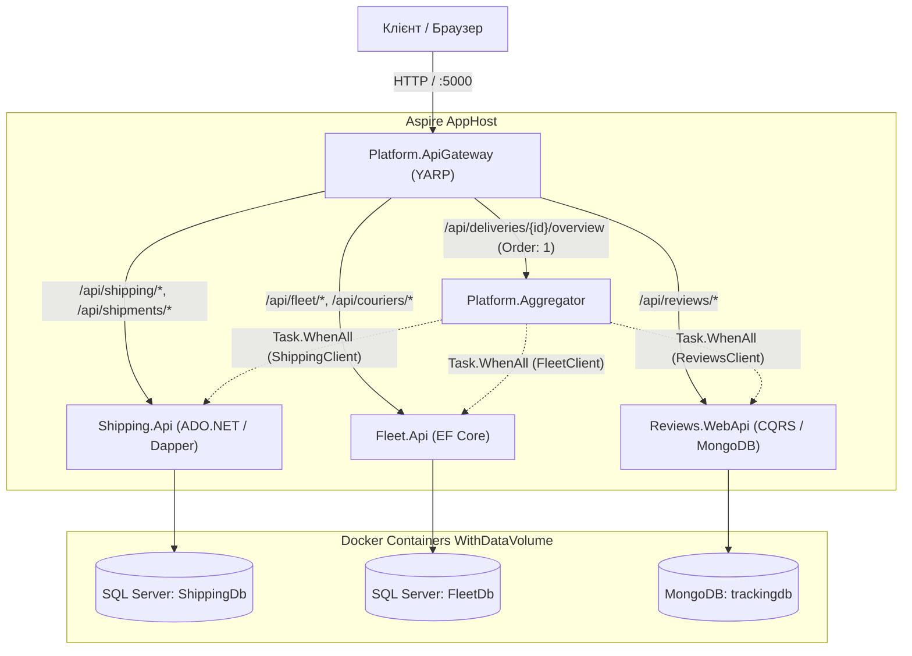

# Лаб. 01 — Проєктування БД для мікросервісної архітектури

**Тема:** Доставка та логістика

## Предметна область

Сервіс кур'єрської доставки: клієнти оформлюють відправлення, компанія
призначає кур'єрів і транспорт зі свого автопарку, отримувачі відстежують
посилку та залишають відгуки. Детальний опис контекстів — `docs/contexts.md`.

## Три bounded context і три бази

| Контекст | Технологія | БД | Папка зі скриптами |
|---|---|---|---|
| **Shipping** (відправлення) | SQL Server + ADO.NET/Dapper | `ShippingDb` | `db/p1/` |
| **Fleet** (автопарк, маршрути) | SQL Server + EF Core (схема; реалізація — Лаб. 03) | `FleetDb` | `db/p2/` |
| **Tracking & Reviews** | MongoDB | `trackingdb` | `db/p3/` |

Між базами немає жодного `FOREIGN KEY` — лише логічні id-посилання. Детальніше
про дубльовані поля — `docs/dedup-policy.md`.

## Документація

- `docs/contexts.md` — опис домену та меж контекстів
- `docs/dedup-policy.md` — таблиця політики дублювання даних
- `docs/erd-p1.md`, `docs/erd-p2.md` — ERD-діаграми (Mermaid)
- `docs/mongo-model.md` — модель колекцій MongoDB, приклади документів і запитів

## Розгортання з нуля

### Вимоги
SQL Server (Developer/Express, 2019+), SSMS або Azure Data Studio, MongoDB 6+,
mongosh.

### Проєкт №1 — Shipping (SQL Server)
```bash
sqlcmd -S <server> -i db/p1/schema.sql
sqlcmd -S <server> -i db/p1/procedures.sql
sqlcmd -S <server> -i db/p1/seed.sql
```
Або відкрий файли по черзі в SSMS і виконай (F5): `schema.sql` →
`procedures.sql` → `seed.sql`.

**Перевірка:**
```sql
USE ShippingDb;
SELECT name FROM sys.procedures ORDER BY name;      -- має бути 6 процедур
SELECT * FROM sys.foreign_keys;                       -- усі FK лише в межах цієї БД
EXEC dbo.usp_GetCustomerShipments @CustomerId = 1, @Page = 1, @PageSize = 10;
```

### Проєкт №2 — Fleet (SQL Server)
```bash
sqlcmd -S <server> -i db/p2/schema.sql
sqlcmd -S <server> -i db/p2/seed.sql
```
**Перевірка:**
```sql
USE FleetDb;
SELECT * FROM sys.foreign_keys;   -- усі FK лише в межах цієї БД
SELECT * FROM dbo.CourierZones;   -- M:N з власним полем AssignedAt
```

### Проєкт №3 — Tracking & Reviews (MongoDB)
```bash
mongosh --file db/p3/collections.js
mongosh --file db/p3/seed.js
```
**Перевірка:**
```javascript
use("trackingdb");
db.reviews.find();              // документи різної структури (rating / photo_review)
db.shipment_tracking.find();
db.getCollectionNames();        // shipment_tracking, reviews, discussions, incidents
```

### Порядок для всього репозиторію
1. `db/p1/schema.sql` → `db/p1/procedures.sql` → `db/p1/seed.sql`
2. `db/p2/schema.sql` → `db/p2/seed.sql`
3. `db/p3/collections.js` → `db/p3/seed.js`

Усі seed-скрипти ідемпотентні: повторний запуск не створює дублікатів
(перевірка `IF NOT EXISTS` / `updateOne(... , { upsert: true })`).

## Таблиця політики дублювання (коротко)

| Поле | Де | Джерело | Політика |
|---|---|---|---|
| `Shipments.AssignedCourierName/Phone` | p1 | p2.Couriers | copy-for-read, подія `CourierUpdated` |
| `ShipmentServices.ServiceName/UnitPrice` | p1 | p1.ServiceTypes | знімок, не оновлюється |
| `shipment_tracking.currentStatus` | p3 | p1.Shipments | copy-for-read, подія `ShipmentStatusChanged` |
| `shipment_tracking.courier.*`, `reviews.courierName` | p3 | p2.Couriers | copy-for-read, подія `CourierUpdated` |

Повна версія — `docs/dedup-policy.md`.

## Лаб. 02 — Shipping.Api: тришарова архітектура на ADO.NET та Dapper

### Структура рішення

```
Platform.slnx
Platform.AppHost/              # оркестрація через .NET Aspire
Services/Shipping/
├── Shipping.Api/               # контролери, Program.cs, appsettings.json
├── Shipping.Bll/                # сервіси, DTO, профіль AutoMapper
├── Shipping.Dal/                 # репозиторії (ADO.NET + Dapper), Unit of Work
└── Shipping.Domain/              # моделі, доменні винятки
```

Залежності спрямовані в один бік: `Api → Bll → Dal`, `Domain` підключають і `Dal`, і `Bll`. Контролери звертаються лише до сервісів BLL, ніколи — до репозиторіїв напряму.

### Що реалізовано

- **DAL:** `IGenericRepository<T>` + спеціалізовані інтерфейси; `CustomerRepository` — чистий ADO.NET (SqlConnection/SqlCommand, ручне читання SqlDataReader); `ShipmentRepository` і `ServiceTypeRepository` — Dapper, спільний CRUD у `BaseDapperRepository<T>`; `UnitOfWork` з одним з'єднанням і транзакцією (рівень ізоляції `ReadCommitted`, обґрунтування — у коментарі `UnitOfWork.cs`).
- **BLL:** DTO з DataAnnotations, профіль AutoMapper `ShippingProfile`, сервіси `ShipmentService`/`CustomerService` з доменними винятками `NotFoundException`/`BusinessConflictException`/`ValidationException`.
- **Флагманська транзакційна операція** — `ShipmentService.ConfirmAsync`: виклик `usp_ConfirmShipment` (репозиторій Shipments) + оновлення клієнта `TouchAsync` (репозиторій Customers) в одній транзакції Unit of Work; при помилці — повний відкат.
- **API:** тонкі контролери `ShipmentsController`/`CustomersController`, атрибутна маршрутизація, `CreatedAtAction` для 201, `NoContent` для 204; `DomainExceptionHandler` централізовано перетворює винятки на `ProblemDetails` (404/409/400); Swagger підключено в `Program.cs`.
- **Aspire:** `Platform.AppHost/AppHost.cs` реєструє ресурс підключення `ShippingDb` (той самий ключ, що і в `appsettings.json` сервісу) і передає його в `Shipping.Api` через `WithReference`.

### Запуск

1. База `ShippingDb` має бути розгорнута за інструкцією з Лаб. 01 (`db/p1/schema.sql → procedures.sql → seed.sql`).
2. Перевір/онови рядок підключення в `Platform.AppHost/appsettings.json` і `Services/Shipping/Shipping.Api/appsettings.json` (ключ `ConnectionStrings:ShippingDb`).
3. З кореня репозиторію:
   ```bash
   dotnet restore
   dotnet run --project Platform.AppHost
   ```
4. Відкрий посилання на **Aspire Dashboard** з консолі — ресурс `shipping-api` має мати статус **Running**.
5. Візьми фактичний HTTPS endpoint ресурсу `shipping-api` з Dashboard і відкрий його з `/swagger`. Порт API призначається Aspire динамічно.
6. У поточній конфігурації SQL Server Express є локальною залежністю: Aspire передає connection string через `WithReference`, але не створює локальний SQL Server.

`Platform.DatabaseInitializer` є одноразовим startup-компонентом контейнерного
режиму. Його повторний запуск безпечний для вже підготовленої бази завдяки
`CREATE OR ALTER` процедур і idempotent seed.

Для перевірки автоматичних тестів:

```bash
dotnet test Services/Shipping/Shipping.Tests/Shipping.Tests.csproj
```

Інтеграційний тест використовує реальний SQL Server лише коли задано
`SHIPPING_TEST_CONNECTION_STRING`. Рядок має вказувати на окрему тестову базу,
назва якої містить `test`; тест створює схему, процедури й seed, а після виконання
видаляє цю базу. Не вказуй робочу базу:

```powershell
$env:SHIPPING_TEST_CONNECTION_STRING = "Server=.\SQLEXPRESS;Database=ShippingLab02Test;Trusted_Connection=True;TrustServerCertificate=True"
dotnet test Services/Shipping/Shipping.Tests/Shipping.Tests.csproj
```

### Приклади запитів

```bash
# Візьми API_BASE_URL із Aspire Dashboard, наприклад https://localhost:49741
# Клієнти
curl -k -X POST ${API_BASE_URL}/api/customers \
  -H "Content-Type: application/json" \
  -d '{"fullName":"Іван Петренко","phone":"+380501112233","email":"ivan@example.com"}'

# Створення відправлення
curl -k -X POST ${API_BASE_URL}/api/shipments \
  -H "Content-Type: application/json" \
  -d '{
    "customerId": 1,
    "senderAddress": "Чернівці, вул. Руська, 100",
    "recipientName": "Коваль Ірина",
    "recipientPhone": "+380931234567",
    "recipientAddress": "Київ, вул. Хрещатик, 5",
    "weightKg": 2.5,
    "declaredValue": 1000,
    "items": [ { "serviceTypeId": 1, "quantity": 1 } ]
  }'

# Підтвердження (транзакційна операція, 204 або 404/409)
curl -k -X POST ${API_BASE_URL}/api/shipments/1/confirm

# Повторне підтвердження -> 409 ProblemDetails
curl -k -i -X POST ${API_BASE_URL}/api/shipments/1/confirm

# Неіснуючий Id -> 404, а не 500
curl -k -i ${API_BASE_URL}/api/shipments/999999
```

### Перевірка перед здачею

- [ ] Передай значення зі спецсимволом (`O'Brien`) — синтаксичної помилки SQL не виникає (параметризація).
- [ ] Викликай `confirm` для вже підтвердженого відправлення — очікується `409` у форматі ProblemDetails.
- [ ] Запроси неіснуючий `Id` — очікується `404`, не `500`.
- [ ] `dotnet run --project Platform.AppHost` — у Dashboard `shipping-api` і база мають статус Running.
- [ ] `/swagger` відкривається і показує всі ендпоінти.

---

## Лаб. 03 — Fleet.Api: тришарова архітектура на EF Core (Code-First)

### Структура

```
Services/Fleet/
├── Fleet.Api/      контролери, ErrorHandling/, Program.cs, appsettings.json, Dockerfile
├── Fleet.Bll/      сервіси, Dto/, Mapping/, Validators/, Specifications/
├── Fleet.Dal/      FleetDbContext, Configurations/, Migrations/, Repositories/, UnitOfWork, Seeding/
└── Fleet.Domain/   сутності з бізнес-правилами, доменні винятки
```

Залежності: `Api → Bll → Dal`, `Domain` підключають `Dal` і `Bll`. Контролери не звертаються до `DbContext` чи репозиторіїв напряму, лише до сервісів BLL.

### Що реалізовано

- **Code-First + Fluent API:** окремий `IEntityTypeConfiguration<T>` для кожної сутності, підключені централізовано через `ApplyConfigurationsFromAssembly`. Зв'язки: 1:1 `Courier ↔ CourierLicense` (PK=FK), 1:N `Warehouse → Vehicle/Courier`, M:N `Courier ↔ DeliveryZone` через `CourierZone` (власне поле `AssignedAt`).
- **Бізнес-правила в сутностях (без відкритих setter-ів):**
  - `Vehicle`: перевірка `CapacityKg > 0` у конструкторі та методі `ChangeCapacity(decimal)`.
  - `Route`: перевірка `PlannedDistanceKm >= 0`; методи `Start()`, `Complete()`, `Cancel()` валідують допустимі переходи статусів (`Planned → InProgress → Completed` та `Planned/InProgress → Cancelled`), інакше кидають `DomainException`.
  - `Courier`: метод `AssignToZone(DeliveryZone zone)` перевіряє унікальність призначення і додає `CourierZone`.
- **Репозиторії та Unit of Work:**
  - `Async Generic Repository` над `DbSet<T>` (`GetByIdAsync`, `GetAllAsync`, `AddAsync`, `Update`, `Delete`, `ListAsync`, `CountAsync`).
  - `CourierRepository` (**Eager Loading**): `GetWithDetailsAsync` завантажує кур'єра, ліцензію, склад і зони одним SQL-запитом через `Include` / `ThenInclude`.
  - `WarehouseRepository` (**Explicit Loading**): `GetWithVehiclesAsync` завантажує склад 1-м запитом, а колекцію транспорту — 2-м запитом через `Entry.Collection.LoadAsync`.
  - `CourierZoneRepository` (**LINQ to Entities для M:N**): `GetCouriersAssignedSinceAsync` робить вибірку через проміжну сутність.
  - `UnitOfWork` об'єднує репозиторії з єдиним `SaveChangesAsync()`.
- **Пагінація, фільтрація, сортування на рівні SQL:**
  - `CouriersFilterSpec` рахує `totalCount` усіх відповідних записів у БД.
  - `CouriersPageSpec` застосовує `Where`, `OrderBy`, `Skip` та `Take` — база повертає лише потрібну сторінку.
  - Метадані пагінації повертаються і в тілі відповіді (`PagedResult<T>`), і в HTTP-заголовках (`X-Total-Count`, `X-Page`, `X-Page-Size`).
- **Валідація:** DataAnnotations на DTO для простих правил + FluentValidation для складних бізнес-правил (формат телефону, код складу, номер знака) з явною перевіркою та відповіддю `ValidationProblemDetails` (HTTP 400).
- **Централізована обробка помилок:** `DomainExceptionHandler` (`IExceptionHandler`) мапить винятки на стандартизовані коди ProblemDetails: `EntityNotFoundException` → 404, `ValidationException` → 400, `ConflictException` / `DomainException` / `DbUpdateConcurrencyException` → 409, непередбачені помилки → 500.
- **Serilog:** структуровані логи, збагачення контексту (`CorrelationId`, `RequestPath`), вивід команд SQL EF Core на рівні `Information`.
- **Сідінг:**
  - Модельний (`HasData`) у конфігураціях для довідників (склади `CV-01`, `KY-01` та зони `Центр`, `Околиці`, `Міжміська`).
  - Програмний ідемпотентний `DbInitializer` після `MigrateAsync()` з перевіркою `AnyAsync` (транспорт `AA1234BT`, кур'єр `Андрій Мельник`, ліцензія `AB123456`, призначення в зону `Центр`).

### База даних і міграції

Сервіс налаштований на роботу з базою `FleetEfDb` (щоб уникнути конфліктів з існуючою базою `FleetDb` з Лаб. 01).
> [!NOTE]
> Якщо потрібно використовувати базу з назвою `FleetDb`, перед виконанням міграцій слід виконати `DROP DATABASE FleetDb;` у SQL Server, оскільки міграції EF Core створюють таблиці самостійно.

Команди міграцій:
```bash
dotnet tool install --global dotnet-ef
dotnet ef migrations add InitialCreate --project Services/Fleet/Fleet.Dal --startup-project Services/Fleet/Fleet.Api
dotnet ef database update --project Services/Fleet/Fleet.Dal --startup-project Services/Fleet/Fleet.Api
dotnet ef migrations script --project Services/Fleet/Fleet.Dal --startup-project Services/Fleet/Fleet.Api -o Services/Fleet/Fleet.Dal/Migrations/InitialCreate.sql
```

Міграції також застосовуються автоматично під час старту застосунку (`MigrateAsync`).

### Запуск

```bash
# Окремий запуск Fleet.Api (порт за замовчуванням: http://localhost:5080)
dotnet run --project Services/Fleet/Fleet.Api

# Або запуск всього рішення через Aspire AppHost
dotnet run --project Platform.AppHost
```

Swagger UI доступний за адресою: `http://localhost:5080/swagger`

### Приклади запитів (порт 5080 або порт з Aspire Dashboard)

```bash
# 1. Список кур'єрів з пагінацією, фільтрацією та сортуванням
curl "http://localhost:5080/api/couriers?page=1&pageSize=5&search=Андр&sortBy=name&sortDir=desc"

# 2. Кур'єр з деталями (Eager Loading — 1 SQL-запит)
curl http://localhost:5080/api/couriers/1

# 3. Склад з транспортом (Explicit Loading — 2 SQL-запити)
curl http://localhost:5080/api/warehouses/1

# 4. Створення кур'єра: 201 Created + заголовок Location
curl -i -X POST http://localhost:5080/api/couriers -H "Content-Type: application/json" \
  -d '{"warehouseId":1,"fullName":"Олексій Шевченко","phone":"+380507654321"}'

# 5. Повторне створення з тим самим номером телефону: 409 Conflict (ProblemDetails)
curl -i -X POST http://localhost:5080/api/couriers -H "Content-Type: application/json" \
  -d '{"warehouseId":1,"fullName":"Олексій Шевченко","phone":"+380507654321"}'

# 6. Помилка валідації (порожнє ім'я): 400 Bad Request (ValidationProblemDetails)
curl -i -X POST http://localhost:5080/api/couriers -H "Content-Type: application/json" \
  -d '{"warehouseId":1,"fullName":"","phone":"+380507654321"}'

# 7. Запит неіснуючого ресурсу: 404 Not Found (ProblemDetails)
curl -i http://localhost:5080/api/couriers/999999

# 8. M:N: Кур'єри зони за останні 30 днів
curl "http://localhost:5080/api/zones/Центр/couriers"

# 9. Планування маршруту: 201 Created + Location
curl -i -X POST http://localhost:5080/api/routes -H "Content-Type: application/json" \
  -d '{"courierId":1,"vehicleId":1,"zoneId":1,"plannedDate":"2026-11-01","plannedDistanceKm":55.0}'

# 10. Життєвий цикл маршруту: старт (204) та завершення (204)
curl -i -X POST http://localhost:5080/api/routes/1/start
curl -i -X POST http://localhost:5080/api/routes/1/complete

# 11. Зміна місткості транспорту (200 OK)
curl -i -X PUT http://localhost:5080/api/vehicles/1/capacity -H "Content-Type: application/json" \
  -d '{"capacityKg":1200.0}'
```

---

## Лаб. 04 — Reviews.WebApi: Clean Architecture на MongoDB та CQRS (MediatR)

### Структура рішення

```
Services/Reviews/
├── Reviews.Domain/          # Сутності (Review, Incident, Discussion), Value Objects (Rating, ReviewCriteria, ReviewComment), доменні винятки
├── Reviews.Application/     # CQRS Commands/Queries, MediatR Behaviors (Validation, Logging, Performance), DTO, FluentValidation
├── Reviews.Infrastructure/  # MongoDbContext, MongoClassMappings, Репозиторії (MongoRepository, ReviewRepository), ReviewQueries, Seeding, Індекси
└── Reviews.WebApi/          # Контролери (ReviewsController), ErrorHandling (ProblemDetails), Mapping (AutoMapper), Program.cs
```

Залежності відповідають канонічній **Clean Architecture**:
`Domain` (чистий C# без зовнішніх залежностей) ← `Application` (бізнес-логіка, CQRS) ← `Infrastructure` (MongoDB.Driver) & `WebApi` (презентаційний шар).

### Що реалізовано

- **Доменний шар (Domain):**
  - Агрегат-корінь `Review` з інкапсульованими методами (`UpdateDetails`, `AddComment`, `Delete`) та приватними сеттерами.
  - Незмінні Value Objects: `Rating` (1..5), `ReviewCriteria` (швидкість, ввічливість, пакування), `ReviewComment`, `DiscussionMessage`.
  - Сутності `Incident` та `Discussion` для відстеження проблем доставки.
  - Доменні винятки: `DomainValidationException`, `DomainConflictException`, `ReviewNotFoundException`, `ConcurrencyException`.
- **Шар застосунку (Application & CQRS):**
  - Розділення операцій через **MediatR**: команди (`CreateReviewCommand`, `UpdateReviewCommand`, `DeleteReviewCommand`, `AddCommentCommand`) та запити (`GetReviewByIdQuery`, `GetReviewsQuery`).
  - **MediatR Pipeline Behaviors**:
    - `ValidationBehavior` — автоматична валідація запитів через **FluentValidation**.
    - `LoggingBehavior` — структуроване логування початку та завершення виконання команд і запитів.
    - `PerformanceBehavior` — фіксація запитів із тривалістю понад 500 мс.
- **Шар інфраструктури (Infrastructure & MongoDB):**
  - Офіційний `MongoDB.Driver` без прив'язки доменних класів до BSON-атрибутів: конфігурація винесена в `MongoClassMappings` (`BsonClassMap`, конвенція `camelCase`).
  - Оптимістичне блокування (Concurrency Control) за допомогою поля `Version` у `BaseEntity`.
  - Спеціалізований сервіс швидкого читання `IReviewQueries` / `ReviewQueries` з пагінацією (`Skip`/`Limit`), сортуванням та фільтрацією за `courierId`, `customerId`, `shipmentId`, `minRating`, `searchText`.
  - Автоматичне створення індексів (`MongoIndexConfigurator`): текстовий індекс за описом і коментарями, складені індекси для швидкої фільтрації.
  - Ідемпотентний сідер початкових даних (`MongoDataSeeder`).
- **Презентаційний шар (WebApi):**
  - RESTful API контролер `ReviewsController` з поверненням коректних статус-кодів (201 Created з Location-заголовком, 200 OK, 204 NoContent).
  - Централізована обробка помилок через `GlobalExceptionHandler` (`IExceptionHandler`) у стандарті RFC 7807 (`ProblemDetails`, `ValidationProblemDetails`).

### Запуск

```bash
# Окремий запуск Reviews.WebApi (порт за замовчуванням: http://localhost:5030)
dotnet run --project Services/Reviews/Reviews.WebApi

# Або у складі платформи через Aspire
dotnet run --project Platform.AppHost
```

Swagger UI доступний за адресою: `http://localhost:5030/swagger`

### Приклади запитів (порт 5030 або через Gateway на 5000)

```bash
# 1. Отримання списку відгуків з пагінацією та фільтрацією
curl "http://localhost:5000/api/reviews?shipmentId=1&page=1&pageSize=10"

# 2. Отримання відгуку за Id
curl http://localhost:5000/api/reviews/6620f123456789abcdef0001

# 3. Створення нового відгуку (201 Created + Location)
curl -i -X POST http://localhost:5000/api/reviews \
  -H "Content-Type: application/json" \
  -d '{
    "shipmentId": 1,
    "customerId": 1,
    "courierId": 1,
    "courierName": "Андрій Мельник",
    "type": "rating",
    "rating": 5,
    "text": "Доставка вчасно, кур’єр дуже ввічливий",
    "criteria": { "speed": 5, "politeness": 5, "packaging": 4 }
  }'

# 4. Додавання коментаря до відгуку (200 OK)
curl -i -X POST http://localhost:5000/api/reviews/6620f123456789abcdef0001/comments \
  -H "Content-Type: application/json" \
  -d '{
    "author": "Менеджер",
    "text": "Дякуємо за ваш відгук!"
  }'

# 5. Оновлення відгуку з контролем версії (204 No Content)
curl -i -X PUT http://localhost:5000/api/reviews/6620f123456789abcdef0001 \
  -H "Content-Type: application/json" \
  -d '{
    "version": 1,
    "rating": 4,
    "text": "Оновлений текст відгуку"
  }'

# 6. Видалення відгуку (м’яке видалення, 204 No Content)
curl -i -X DELETE "http://localhost:5000/api/reviews/6620f123456789abcdef0001?version=1"
```

---

## Лаб. 05 — Мікросервісна платформа на .NET Aspire, YARP, OpenTelemetry та Aggregator

### 1. Призначення платформи та опис мікросервісів

Платформа забезпечує повний життєвий цикл кур'єрської доставки та логістики за розподіленою мікросервісною архітектурою, оркестрованою за допомогою **.NET Aspire**:

1. **Shipping Service (`Services/Shipping/Shipping.Api`)**:
   - Технологічний стек: **ADO.NET + Dapper**, база даних **SQL Server (`ShippingDb`)**.
   - Домен: керування клієнтами та оформлення відправлень/посилок.
2. **Fleet Service (`Services/Fleet/Fleet.Api`)**:
   - Технологічний стек: **Entity Framework Core (Code-First)**, база даних **SQL Server (`FleetDb`)**.
   - Домен: автопарк, склади, ліцензії, кур'єри, зони обслуговування та маршрути.
3. **Reviews Service (`Services/Reviews/Reviews.WebApi`)**:
   - Технологічний стек: **Clean Architecture + CQRS (MediatR)**, документоорієнтована база даних **MongoDB (`trackingdb`)**.
   - Домен: відгуки клієнтів, оцінки якості доставки, обговорення та інциденти.
4. **API Gateway (`Platform.ApiGateway`)**:
   - Зворотний проксі-сервер на базі **YARP (Yet Another Reverse Proxy)**.
   - Забезпечує єдину точку входу (фіксований порт **5000**), резолвінг імен через Aspire Service Discovery, пріоритетну маршрутизацію та логування запитів.
5. **Aggregator (`Platform.Aggregator`)**:
   - Сервіс композитного агрегування даних.
   - Виконує паралельні виклики (`Task.WhenAll`) через типізовані `HttpClient`, обробляє часткові відмови та повертає композитний DTO `ShipmentOverviewDto`.
6. **Service Defaults (`Platform.ServiceDefaults`)**:
   - Спільна конфігурація для всіх сервісів: Serilog зі збагаченням та виводом у `CompactJsonFormatter`, наскрізний `X-Correlation-Id` (Middleware + DelegatingHandler), OpenTelemetry (HTTP, SQL, MongoDB, власні Spans) та Health Checks.

---

### 2. Архітектура та взаємодія компонентів



---

### 3. Необхідні інструменти та версії SDK

- **.NET SDK:** 8.0 або 10.0 (проєкти націлені на `net8.0`).
- **.NET Aspire:** 9.0.0.
- **Docker Desktop / Podman:** для запуску контейнерів SQL Server і MongoDB.
- **YARP Reverse Proxy:** 2.2.0.

---

### 4. Запуск платформи через Aspire AppHost

#### 4.1. Налаштування секретів конфігурації
Пароль до контейнера SQL Server не зашитий у коді, а безпечно передається через параметри Aspire:
```bash
dotnet user-secrets set "Parameters:sql-password" "Your_Strong_Password123!" --project Platform.AppHost
```

#### 4.2. Запуск всієї платформи однією командою:
```bash
dotnet run --project Platform.AppHost
```
Після запуску відкриється веб-панель **Aspire Dashboard**, де відображаються стан усіх сервісів, метрики, структуровані логи та розподілені траси OpenTelemetry.

---

### 5. Постійне сховище (Persistent Storage) контейнерів

У [AppHost.cs](file:///D:/Programming/.net-labs/Platform.AppHost/AppHost.cs) для SQL Server та MongoDB налаштовано постійне сховище за допомогою `.WithDataVolume()`:
- SQL Server: `builder.AddSqlServer("sql", password).WithDataVolume()`
  - Бази даних: `ShippingDb`, `FleetDb`.
- MongoDB: `builder.AddMongoDB("mongodb").WithDataVolume()`
  - База даних: `trackingdb`.

Завдяки `WithDataVolume()` дані зберігаються між перезапусками контейнерів.

Порядок старту гарантується викликами `WaitFor`:
`Databases -> Microservices -> Aggregator -> Gateway`.

---

### 6. Адресація API Gateway та маршрутизація

- **Фіксований порт Gateway:** `http://localhost:5000`
- **Пріоритети маршрутів (Order):**
  - `Order: 1`: `/api/deliveries/{**catch-all}` -> `http://aggregator`
  - `Order: 10..12`: `/api/shipping/{**catch-all}`, `/api/shipments/{**catch-all}`, `/api/customers/{**catch-all}` -> `http://shipping-api`
  - `Order: 20..25`: `/api/fleet/{**catch-all}`, `/api/couriers/{**catch-all}`, `/api/routes/{**catch-all}`, `/api/vehicles/{**catch-all}`, `/api/warehouses/{**catch-all}`, `/api/zones/{**catch-all}` -> `http://fleet-api`
  - `Order: 30`: `/api/reviews/{**catch-all}` -> `http://reviews-webapi`

---

### 7. Приклади HTTP-запитів (через Gateway на порту 5000)

#### 7.1. Запит до Shipping.Api:
```bash
# Отримання інформації про відправлення
curl -i http://localhost:5000/api/shipments/1

# Через префікс домену
curl -i http://localhost:5000/api/shipping/shipments/1
```

#### 7.2. Запит до Fleet.Api:
```bash
# Отримання інформації про кур'єра
curl -i http://localhost:5000/api/couriers/1

# Через префікс домену
curl -i http://localhost:5000/api/fleet/couriers/1
```

#### 7.3. Запит до Reviews.WebApi:
```bash
# Отримання списку відгуків з фільтром за відправленням
curl -i "http://localhost:5000/api/reviews?shipmentId=1"
```

#### 7.4. Запит до Aggregator (Композитний ендпоінт):
```bash
# Огляд доставки (об'єднує Shipping + Fleet + Reviews)
curl -i "http://localhost:5000/api/deliveries/1/overview?courierId=1"

# З передачею власного Correlation ID для наскрізного трасування
curl -i -H "X-Correlation-Id: custom-trace-guid-12345" "http://localhost:5000/api/deliveries/1/overview"
```

---

### 8. Наскрізний `X-Correlation-Id`, структуроване логування та OpenTelemetry

1. **CorrelationId Middleware (`Platform.ServiceDefaults/Correlation/CorrelationIdMiddleware.cs`):**
   - Перевіряє наявність заголовка `X-Correlation-Id` у вхідному запиті. Якщо він відсутній — генерує новий `Guid`.
   - Записує значення в `LogContext.PushProperty("CorrelationId", ...)` та в заголовок HTTP-відповіді.
2. **CorrelationId DelegatingHandler (`Platform.ServiceDefaults/Correlation/CorrelationIdDelegatingHandler.cs`):**
   - Автоматично додає заголовок `X-Correlation-Id` до кожного вихідного виклику типізованих HTTP-клієнтів (`ShippingClient`, `FleetClient`, `ReviewsClient`).
   - Забезпечує наскрізну кореляцію за ланцюжком: `Gateway -> Aggregator -> Мікросервіс`.
3. **Serilog:**
   - Збагачується властивостями: `ServiceName`, `Environment`, `MachineName`, `ThreadId`, `FromLogContext`.
   - Форматування логів: `CompactJsonFormatter`.
   - `writeToProviders: true`: автоматично передає логи до OpenTelemetry.
4. **OpenTelemetry та власні Spans:**
   - Автоматична інструментація: ASP.NET Core, HttpClient, SqlClient, MongoDB Commands.
   - Власний `ActivitySource`: `Platform.Diagnostics`.
   - Ключові бізнес-операції створюють Spans: `Shipping.CreateShipment`, `Shipping.ConfirmShipment`, `Fleet.PlanRoute`, `Reviews.CreateReview`.
   - Експорт через OTLP за допомогою `.UseOtlpExporter()`.

---

### 9. Часткові відмови в Aggregator (Partial Failures)

Якщо один із мікросервісів недоступний або повертає помилку:
- Aggregator **НЕ** повертає HTTP 500.
- Aggregator повертає **HTTP 200 OK** з доступними частинами даних та заповненим масивом `warnings`.
- Приклад відповіді при недоступності сервісу відгуків:
```json
{
  "shipmentId": 1,
  "status": "Created",
  "shipment": {
    "id": 1,
    "customerId": 1,
    "status": "Created",
    "recipientName": "Іван Коваленко",
    "weightKg": 4.5
  },
  "courier": {
    "id": 1,
    "fullName": "Андрій Мельник",
    "status": "Active"
  },
  "warnings": [
    "Reviews service returned status 503 (Service Unavailable) for shipment 1"
  ]
}
```

---

### 10. Типові проблеми та діагностика

1. **Помилка `Docker is not running`:**
   - Переконайтеся, що Docker Desktop запущено перед виконанням `dotnet run --project Platform.AppHost`.
2. **Конфлікт порту 5000:**
   - Перевірте, чи порт 5000 не зайнятий іншою програмою (`netstat -ano | findstr :5000`).
3. **Не вдається з'єднатися з базою даних у тестах або автономному режимі:**
   - При запуску поза Aspire перевірте наявність локальних рядків підключення у відповідних `appsettings.json`.
4. **Перевірка трасування OpenTelemetry:**
   - Відкрийте веб-панель Aspire Dashboard (посилання виводиться в консолі при старті `Platform.AppHost`).
   - Перейдіть у розділ **Traces** або **Structured Logs**, знайдіть свій `X-Correlation-Id` та перегляньте детальний ланцюжок спанів між усіма компонентами платформи.